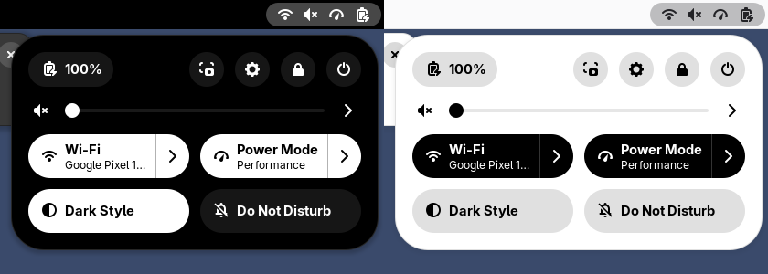
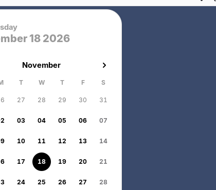
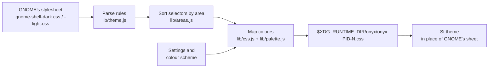

<h1 align="center">Onyx</h1>

<p align="center">
  
  
  
  
</p>

<p align="center">True black in dark mode, true white in light mode, and a monochrome accent for GNOME Shell.</p>

---



GNOME Shell draws its menus, dialogs and panels in dark grey (`#36363a`) in dark mode and in off-white in light mode, with the system accent colour on active controls. **Onyx** puts them on **pure black** or **pure white** and makes the accent **monochrome**: white with black content in dark mode, black with white content in light mode. The **top bar** is left alone, so **Transparent Top Bar**, **Blur my Shell** and **Islands** keep it.

## What it changes

| **Area** | **Pieces** |
|---|---|
| **Quick Settings and menus** | Quick Settings and their submenus, right-click and top bar menus, sliders, switches, check boxes |
| **Calendar and notifications** | Date menu, notification list, banners, world clocks, weather |
| **Screenshot and OSD** | Screenshot panel, volume and brightness OSD, workspace switcher |
| **Dialogs and Alt-Tab** | Log out, password and system dialogs, window switcher, on-screen keyboard |
| **Overview** | Dash, search entry and results, app folders (the backdrop and the app grid stay dark) |

Every area has its own switch. Buttons, entries and switches that several areas share follow while any area is on.

| **GNOME 50, dark** | **Onyx, dark** | **Onyx, light** |
|---|---|---|
|  |  |  |

## How it works



- **Built from GNOME's own theme:** Onyx reads the stylesheet the shell is using and writes a full copy of it, with GNOME's greys moved onto black or white and `-st-accent-color` replaced by the text colour. Sizes, radii and spacing stay GNOME's. A GNOME update that adds or renames a selector is picked up without a change to Onyx.
- **In GNOME's place, not on top:** the copy replaces GNOME's sheet at the bottom of St's cascade, where the sheets of other extensions win over it as they win over GNOME's. Loaded as an extension sheet on top, GNOME's specific rules (`StEntry:focus`, the dash icons) beat other extensions' own styling: a grey field in Lantern, tiles behind Blur my Shell's transparent dash. When GNOME reloads its theme (scheme or high contrast change, `Main.loadTheme()`), Onyx's copy goes back in.
- **GNOME's order kept:** every rule is written in GNOME's order, so a later GNOME rule still wins over an earlier one. A switched-off area, the top bar and the lock screen keep GNOME's own values.
- **Dark in light:** GNOME keeps the OSD, Alt-Tab, the screenshot panel and the dash dark in its light theme. In light mode Onyx gives these the dark treatment and then inverts them, so they turn white with the rest.
- **Light shell with light apps:** GNOME 50 keeps the whole shell dark unless the colour scheme is `prefer-light`, and the **Dark Style** toggle switches between `prefer-dark` and `default`. With this setting on (the default), `default` gives a light shell too.
- **Cost:** the sheet is built once per change of scheme or setting (*tested* with gjs: about 23 ms) and nothing runs in between. *Tested* headless: 0 to 1 painted frames in 3 idle seconds.
- **High contrast:** when GNOME's high contrast is on, Onyx steps back.

## Settings

| **Setting** | **Default** | **Effect** |
|---|---|---|
| **Light shell with light apps** | on | `default` scheme gives a white shell, not a dark one |
| **Monochrome accent** | on | Off keeps the system accent on active controls |
| **Hairline** | on | 1 px edge (`#262626` dark, `#e0e0e0` light) around menus, dialogs, OSD and dash |
| **Overview surfaces** | Solid | **Transparent** makes dash, search and app folders see-through, with an **opacity** in percent. Blur my Shell, when it is on, blurs behind them; Onyx never switches another extension |
| **Areas** | all on | One switch per area in the table above |

## Install

```bash
git clone https://github.com/tomsliikee/onyx ~/git/onyx   # once published
cd ~/git/onyx
./install.sh
```

Log out and back in. `./install.sh --remove` takes it out again; the settings stay in dconf under **/org/gnome/shell/extensions/onyx/**.

| **Platform** | **State** |
|---|---|
| **Linux, GNOME Shell 50 (Fedora 44)** | *tested* headless (virtual monitor), not yet in a real login |
| **Other GNOME versions** | not listed in `metadata.json`; the selectors come from the running theme, so they may work, *untested* |

## Development

```bash
for t in tests/*.test.js; do gjs -m "$t"; done
```

The unit tests run against the GNOME theme installed on the machine. One of them fails when GNOME's light theme gets a new dark surface Onyx does not know yet.

```bash
ONYX_OUT=/tmp/onyx tools/headless/run.sh surfaces 180
```

Runs a GNOME Shell without a screen, opens every area in dark and light with Onyx on and off, switches an area off, sets the overview to transparent, turns Onyx off and on ten times, and writes screenshots to **$ONYX_OUT/shots**.

## License

MIT
