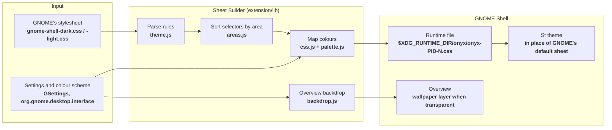
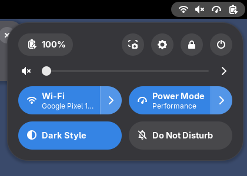
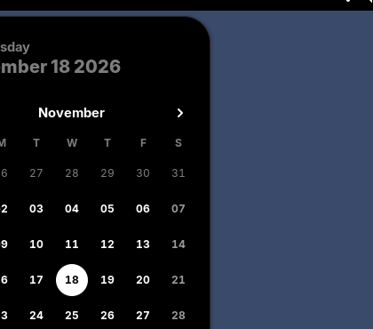

<div align="center">
  
  <h1>Onyx</h1>
  <p><strong>A GNOME Shell extension that puts menus, Quick Settings, notifications, dialogs and the overview on true black in dark mode and true white in light mode, with a monochrome accent. The top bar is left alone.</strong></p>

  <p>
    
    
    
    
    
  </p>
</div>

---


---

**GNOME Shell** draws its menus, dialogs and panels in dark grey (`#36363a`) in dark mode and in off-white in light mode, with the system accent colour on active controls. **Onyx** puts them on **pure black** or **pure white** and makes the accent **monochrome**: white with black content in dark mode, black with white content in light mode. The **top bar** is not touched, so **Transparent Top Bar**, **Blur my Shell** and **Islands** keep it.

Every claim below says how it is known: *tested* (and how), *built* (it loads, but was not tried that way) or *planned*. All checks so far ran on **Fedora 44** with **GNOME Shell 50.6**, in unit tests with **gjs** and in a **headless GNOME Shell** (virtual monitor, 1280x800). Onyx has not yet been used in a real login.

---

## Architecture Overview

**Onyx** has no stylesheet of its own. It reads the one GNOME Shell is using, writes a recoloured copy, and hands that copy to **St** in place of GNOME's.



- **Built from GNOME's Own Theme:** Onyx writes a full copy of the running stylesheet with GNOME's greys moved onto black or white and `-st-accent-color` replaced by the text colour. Sizes, radii and spacing stay GNOME's. A selector that GNOME adds or renames in an update is picked up without a change to Onyx.
- **In GNOME's Place, Not on Top:** the copy replaces GNOME's **default stylesheet** at the bottom of St's cascade, so the sheets of other extensions win over it exactly as they win over GNOME's. Loaded on top instead, GNOME's specific rules (`StEntry:focus`, the dash icons) beat other extensions' styling: a grey field in **Lantern**, tiles behind the transparent dash of **Blur my Shell**. When GNOME reloads its theme (scheme or high contrast change, `Main.loadTheme()`), Onyx puts its copy back.
- **GNOME's Order Kept:** every rule is written in GNOME's order, so a later GNOME rule still wins over an earlier one. A switched-off area, the top bar and the lock screen keep GNOME's own values.
- **Dark Surfaces in Light Mode:** GNOME keeps the OSD, Alt-Tab, the screenshot panel and the dash dark in its light theme. Onyx gives these the dark treatment and then inverts them, so they turn white with the rest.
- **Cost:** the sheet is built once per change of scheme or setting and nothing runs in between. *Tested*: about **23 ms** per sheet in gjs; **0 to 1 painted frames** in 3 idle seconds in the headless shell.

---

## Core Capabilities

- **Quick Settings and Menus:** Quick Settings and their submenus, right-click and top bar menus, sliders, switches and check boxes. A checked quick toggle is inverted. *Tested* (unit tests, headless screenshots dark and light).
- **Calendar and Notifications:** date menu, notification list, banners, world clocks, weather. Notification cards are grey (`#3a3a3a` dark, `#ebebeb` light, darker further down a stack) so they stand apart from the panel. *Tested* (headless screenshots).
- **Screenshot UI and OSD:** screenshot panel, volume and brightness OSD, workspace switcher. *Tested* (headless screenshots).
- **Dialogs and Alt-Tab:** log out, password and system dialogs, window switcher, on-screen keyboard. Modal dialogs *tested* headless; Alt-Tab, polkit and password dialogs and the on-screen keyboard are *built*.
- **Overview:** dash, search entry and results, app folders. Solid by default; **Transparent** makes them see-through and puts the wallpaper behind the overview. With **Blur my Shell** blurring the overview, its blur shows instead. Onyx never switches another extension on or off. *Tested* headless with and without Blur my Shell; app folders *built*.
- **One Switch per Area:** each area above can be turned off and keeps GNOME's look. Buttons, entries and switches that several areas share follow while any area is on. *Tested* (unit tests; headless with the menus area off).
- **Light Shell with Light Apps:** GNOME 50 keeps the shell dark unless the colour scheme is `prefer-light`, while the **Dark Style** toggle switches between `prefer-dark` and `default`. With this setting on, `default` gives a white shell too. *Tested* headless (scheme switch while running); the toggle itself not tried by hand.
- **Soft Mode:** every grey squeezed into a narrower range, dark grey instead of black and light grey instead of white. *Tested* (headless screenshots dark and light).
- **High Contrast:** when GNOME's high contrast is on, Onyx steps back and GNOME's sheet returns. *Tested* headless (round trip).
- **Clean Disable:** turning Onyx off restores GNOME's sheet and leaves no file behind. *Tested* headless: ten off/on cycles leave one sheet, disabling leaves none.

| **GNOME 50, dark** | **Onyx, dark** | **Onyx, light** |
| :--- | :--- | :--- |
|  |  |  |

---

## Settings

| **Setting** | **Default** | **Effect** |
| :--- | :--- | :--- |
| **Light shell with light apps** | **On** | The `default` colour scheme gives a white shell, not a dark one |
| **Monochrome accent** | **On** | Off keeps the system accent colour on active controls |
| **Soft** | **Off** | Greys between `#1c1c1c` and `#e2e2e2` (dark) or `#2a2a2a` and `#f0f0f0` (light), and a softer accent |
| **Hairline** | **On** | 1 px edge (`#262626` dark, `#e0e0e0` light) around menus, dialogs, OSD and dash |
| **Overview surfaces** | **Solid** | **Transparent** with an **opacity** in percent; see the Overview item above |
| **Areas** | **All on** | One switch per area |

The settings window is *built* (Adw); it has not been opened yet.

---

## Platform Support Matrix

| **Platform** | **Shell** | **Status** |
| :--- | :--- | :--- |
| **Fedora 44** | **GNOME Shell 50.6**, Wayland | ***Tested*** in unit tests and a headless shell; not yet in a real login |
| **Other distributions with GNOME 50** | GNOME Shell 50 | ***Untested.*** Onyx only depends on the shell, so it should behave the same |
| **GNOME 49 and older, 51 and newer** | | ***Untested*** and not listed in `metadata.json`. Selectors come from the running theme, so it may work |
| **Other desktops** | | Not planned: Onyx is a GNOME Shell extension |

---

## Building and Running

**1. Clone the repository:**
```bash
git clone https://github.com/tomsliikee/onyx.git ~/git/onyx
cd ~/git/onyx
```

**2. Install for the current user** (compiles the settings schema, links the extension and enables it):
```bash
./install.sh
```

**3. Log out and back in.** GNOME Shell on Wayland loads new extensions only at login.

**Update** with `git pull` and a new login; run `./install.sh` again when the settings schema changed. **Remove** with:
```bash
./install.sh --remove
```

**Tests** run against the GNOME theme installed on the machine. One of them fails when GNOME's light theme gains a dark surface Onyx does not know yet:
```bash
for t in tests/*.test.js; do gjs -m "$t"; done
```

**Headless check:** starts a GNOME Shell without a screen, opens every area in dark and light with Onyx on and off, switches an area off, sets the overview to transparent, turns Onyx off and on ten times, and writes screenshots to **`$ONYX_OUT/shots`**:
```bash
ONYX_OUT=/tmp/onyx tools/headless/run.sh surfaces 180
```

The scripts `backdrop` (overview wallpaper with and without Blur my Shell, loaded with `ONYX_WITH="blur-my-shell@aunetx"`) and `soft` (notification cards and soft mode) run the same way.

---

## Data Storage & Disk Paths

| **File / Directory** | **Description** |
| :--- | :--- |
| **`~/.local/share/gnome-shell/extensions/onyx@thomashaiden`** | Link to `extension/` in the repository, made by `install.sh` |
| **`/org/gnome/shell/extensions/onyx/`** (dconf) | Settings; they stay after `./install.sh --remove` |
| **`$XDG_RUNTIME_DIR/onyx/onyx-PID-N.css`** | The generated sheet, in memory-backed storage; removed when Onyx is turned off |

---

## License

Distributed under the **MIT License**. See [`LICENSE`](LICENSE) for complete terms.
